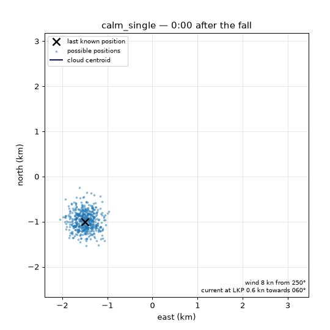
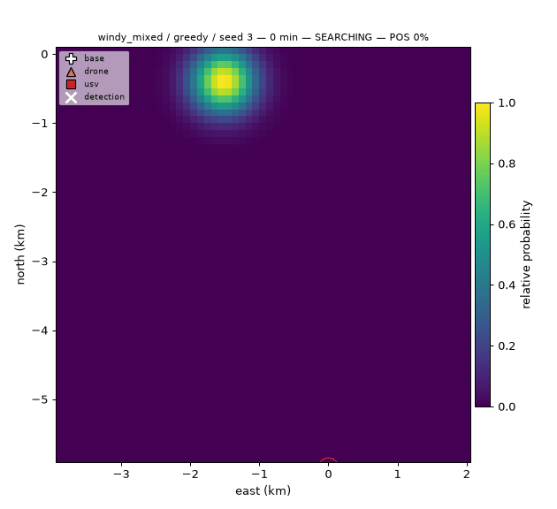

# SeaSwarm

A heterogeneous swarm of drones and autonomous surface vessels searches for a person in water.
SeaSwarm predicts the drift, keeps a Bayesian probability map of where the person may be, splits
the search between vehicles and replans after every sweep, while a human operator directs it in
plain language through an LLM agent over MCP.

Second project of a series on autonomy for drones, maritime and space systems, after
[skypilot-agent](https://github.com/antoinehinary/skypilot-agent).



*500 equally likely realisations of the drift of a person in water over 3 hours: uncertain fall
position, current, and wind-driven leeway with time-correlated noise and random jibing.*

> Work in progress. Not an operational search-and-rescue tool: all drift and detection
> parameters are illustrative values from public literature.

## Quick start

```bash
conda create -n seaswarm python=3.12 -y && conda activate seaswarm
pip install -e ".[dev]"
python scripts/run_search.py --scenario scenarios/windy_mixed.yaml --strategy greedy --seed 3 --gif media/search_greedy_seed3.gif
```

## Status

| Phase | Name | Status |
| --- | --- | --- |
| 1 | World and drift | done |
| 2 | Probability map | done |
| 3 | Vehicles, safety and baseline search | done |
| 4 | Auction planner and evaluation | in progress |
| 5 | Operator agent and MCP server | not started |
| 6 | Polish, publish and stretch | not started |



*Two drones and a USV search the probability map (greedy Bayesian strategy); after a detection
the nearest USV recovers the person. The true position is not shown: the swarm only knows the
map.*

| Fleet 2 drones + 1 USV, 20 seeds | Detected within 60 min | Median time to detection |
| --- | --- | --- |
| windy_mixed, lawnmower baseline | 11/20 | 47.5 min |
| windy_mixed, Bayesian greedy | 16/20 | 30.2 min |
| calm_single, lawnmower baseline | 14/20 | 28.3 min |
| calm_single, Bayesian greedy | 20/20 | 16.4 min |


*The Bayesian probability map (left), predicted with the exact variance of the drift noise,
against 5000 Monte Carlo particles of the drift model (right) after 2 hours.*

Design notes, equations and parameter sources: [docs/design.md](docs/design.md).

## Licence

[AGPL-3.0](LICENSE).
