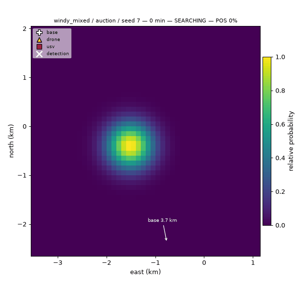
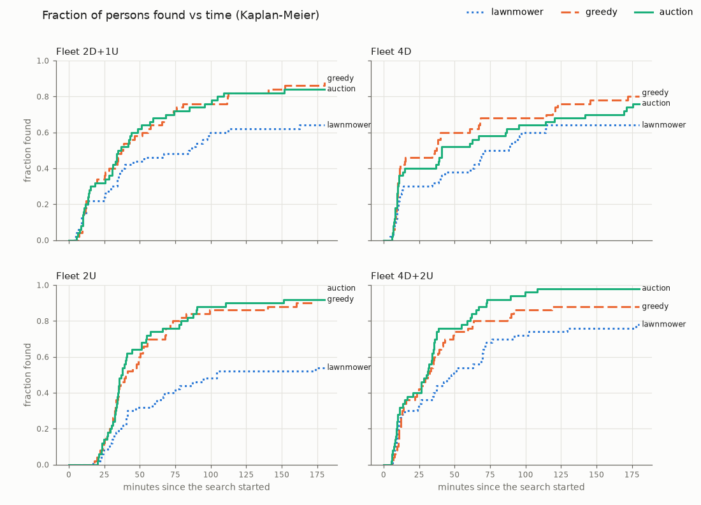
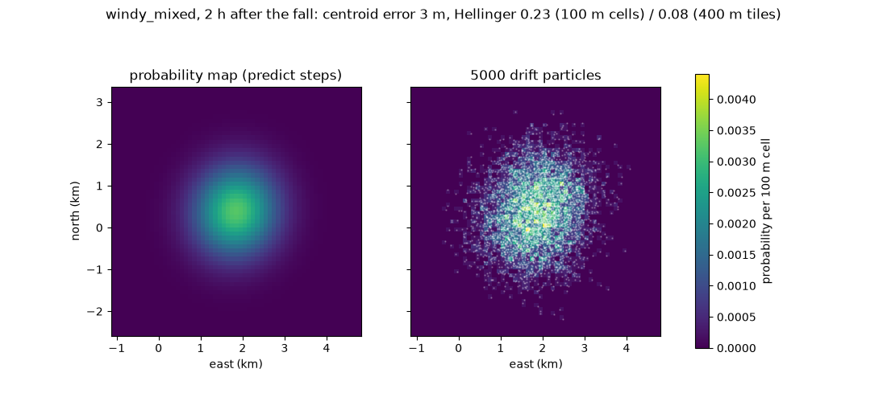

# SeaSwarm

**A drone and boat swarm that searches for a person in the water with a Bayesian probability
map, directed in plain language by an LLM agent through MCP.**



*Four drones and two autonomous boats (USVs) search the probability map with the bundle auction.
A drone detects the person after 14 minutes; the nearest USV recovers them 9 minutes later. The
true position is never shown to the swarm (nor here): it only knows the map.*

> **Not an operational search-and-rescue tool.** A portfolio project: drift and detection
> parameters are illustrative values from public literature, nothing is validated at sea.

## The story

This is the second project of a series on autonomy for drones, maritime and space systems.
[skypilot-agent](https://github.com/antoinehinary/skypilot-agent) lets an LLM fly **one**
simulated Crazyflie through an MCP server and a safety layer. SeaSwarm keeps that architecture
(agent -> MCP tools -> safety layer -> vehicle backend) and scales it to a **coordinated
heterogeneous swarm** with a real estimation problem underneath: where is the person now?

## What it does

1. **Predicts the drift.** A person in water moves with the current plus about 1 % of the wind
   (US Coast Guard leeway coefficients for a person in water), with time-correlated noise and
   random "jibing" from one side of the wind to the other.
2. **Maintains a probability map** of where they may be: predicted forward in time, and updated
   with Bayes' rule after every sensor look, including "searched here, found nothing".
3. **Splits the search** between drones (fast, 25 min batteries, weak at night) and USVs (slow,
   8 h endurance, the only ones that can pick someone up) with a greedy planner or a bundle
   auction, replanning on every event.
4. **Keeps everyone safe**: every command passes a safety layer (geofence, separation by
   altitude layer with predictive conflict checks, energy reserve, one searcher per tile).
5. **Takes orders in plain language** from an operator through an LLM agent that can only call
   ten MCP tools.

## Architecture

```
 Operator (plain language, knots, compass bearings)
        |
 Operator agent            smolagents CodeAgent + local qwen3:8b (Ollama)
        |  MCP over stdio  (never imports the simulator)
 MCP server                10 typed tools, SI units, JSON results, never raises
        |
 Mission coordinator  <->  Probability map
 (lawnmower / greedy /     (predict, Bayes update, POD models)
  auction planners)
        |  proposed commands
 Safety layer              geofence, separation, energy reserve, tile occupancy
        |  accepted commands only        -> Refusal(code, reason) otherwise
 Vehicle backend           2D kinematics + sensors (a real-hardware backend would plug in here)
        |
 World truth               ocean and wind fields, the drifting person (only the sensors see it)
```

## Quick start

```bash
conda create -n seaswarm python=3.12 -y && conda activate seaswarm
pip install -e ".[dev]"
python scripts/run_search.py --scenario scenarios/windy_mixed.yaml --strategy auction --seed 7 --fleet 4D+2U --gif media/my_search.gif
```

The operator agent needs [Ollama](https://ollama.com) with `qwen3:8b`:

```bash
ollama pull qwen3:8b
seaswarm-agent "prioritise the north sector, then send a boat to drone 2's detection" --scenario scenarios/windy_mixed.yaml --seed 14 --warmup-s 520
seaswarm-agent --interactive --scenario scenarios/windy_mixed.yaml
```

Full evaluation (600 runs, about 10 minutes on 4 cores):

```bash
python -m seaswarm.eval.run --strategy lawnmower,greedy,auction --fleet all --seeds 0-49 --workers 4
python -m seaswarm.eval.agent_eval
```

## Results

### Search strategies: 50 random scenarios x 4 fleets x 3 strategies



| Fleet | Found within 60 min: lawnmower | greedy | auction | Median time to find (best) |
| --- | --- | --- | --- | --- |
| 2 drones + 1 USV | 46% | 64% | 68% | 34 min (auction) |
| 4 drones | 38% | 60% | 52% | 36 min (greedy) |
| 2 USVs | 34% | 70% | 74% | 37 min (auction) |
| 4 drones + 2 USVs | 54% | 76% | 80% | 30 min (auction) |

Greedy search of the probability map beats the fixed lawnmower baseline in every fleet, and the
bundle auction in three of four (paired over the same scenarios; with 4 drones its +14 points
are not significant); greedy and auction are statistically tied. **Zero safety violations in
600 runs.** Full table with 95 % bootstrap intervals and paired comparisons:
[results/summary.md](results/summary.md).

### Decentralised allocation (CBBA)

The auction also runs as **CBBA** (consensus-based bundle algorithm): no auctioneer, vehicles
only exchange bids with neighbours within radio range. With full communication it matches the
central auction; at 300 m range, tile conflicts rise to 5-14 per run, yet the fraction found
within 60 min does not drop (every paired interval includes zero): the safety layer refuses the
duplicate and the next replan resolves it. Table in [docs/design.md](docs/design.md#57-decentralised-allocation-cbba-stretch).

### Operator agent: 9/10 instructions with a local 8B model

Ten plain-language instructions with machine-checked outcomes ("focus on the north-east for 20
minutes", "send a boat to drone 2's detection", "have drone 2 search 2 nautical miles north of
the base", ...). qwen3:8b passes 9/10 in about 3 minutes in total on a MacBook. The failure:
asked for a position outside the geofence, it substituted a reachable one instead of reporting
back ([results/agent_eval.md](results/agent_eval.md), [analysis](docs/decisions.md)).

### The probability map matches the drift model



After 2 hours the map's centroid is within 0.15 cells of 5000 Monte Carlo particles of the
drift model and its spread within 2 %; against 100 000 particles the Hellinger distance is 0.05
(calm) to 0.07 (windy).

## How it works (equations in [docs/design.md](docs/design.md))

- **Drift (truth):** `v = U_current + L_d e_downwind + s(t) L_c e_crosswind`, `L = a |W10| + b +
  noise`, PIW-1 coefficients (0.96 % downwind, ±0.54 % crosswind). Noise is Ornstein-Uhlenbeck
  (correlated over 30 min), because white noise at 1 s steps would average out to almost no
  spread. Discretised exactly.
- **Belief predict:** one convolution per minute with `N(v_bar dt, S)`, done in Fourier space:
  exact for sub-cell shifts and any anisotropy, no numerical diffusion. The spread follows the
  exact variance of the drift noise, `2 sigma^2 tau (t - tau (1 - exp(-t/tau)))`; the jibing
  crosswind side is a telegraph process with the same formula.
- **Bayes update after a miss:** `p_i <- p_i (1 - POD_i) / (1 - sum_j p_j POD_j)`, with the POD
  averaged over each cell (a 42 m camera footprint is smaller than a 100 m cell).
- **Search theory:** effective sweep width W per sensor (Koopman), track spacing from W, POD of
  a sweep `1 - exp(-W L / A)` on the effort the battery allows; utility
  `w_prio x POD x p(tile) / (travel + search time)`.
- **Auction and CBBA:** sequential single-item auction with bundles of 3 tiles and a
  time-discounted reward, and its decentralised version CBBA (consensus over a range-limited
  radio network).
- **Evaluation:** Kaplan-Meier "fraction found vs time" (censored runs), bootstrap intervals,
  paired comparisons on identical seeds; `results.csv` is byte-identical for any number of
  workers.

## Repository map

| Path | Content |
| --- | --- |
| `src/seaswarm/world/` | truth: ocean and wind fields, drift model, the person |
| `src/seaswarm/search/` | belief: grid, probability map, motion model, predict, Bayes, POD |
| `src/seaswarm/vehicles/` | backend interface, kinematics, energy, sensors, 2D simulator |
| `src/seaswarm/safety/` | refusal codes, rules, the guard every command goes through |
| `src/seaswarm/planning/` | tiles, utility, lawnmower, greedy and auction planners |
| `src/seaswarm/mission.py`, `operations.py` | the coordinator loop and its operator interface |
| `src/seaswarm/mcp_server/`, `agent/` | MCP tools and the LLM operator agent |
| `src/seaswarm/eval/` | scenario generator, batch runner, statistics, agent evaluation |
| `docs/design.md`, `docs/decisions.md` | equations and assumptions; every design decision with its reason |

## Limitations

- 2D world, synthetic and spatially simple wind and current fields; no coastline, waves or tides.
- Leeway coefficients are fleet averages for one object class; real persons differ.
- Sensor looks are treated as independent and raise no false alarms; detection parameters are
  illustrative, not validated sweep widths.
- The belief uses one Gaussian for the two crosswind lobes and the current at the map's mean; its
  probability of success is slightly optimistic against the truth (within 2 sigma).
- Drones ignore wind; separation predictions assume straight legs; there is no launch or
  approach sequencing at the base.
- The operator agent can substitute its own choice when an order is refused (1 of 10 cases).
- CBBA decentralises the allocation only: every vehicle uses the same probability map.

## References

- A. A. Allen, J. V. Plourde, *Review of Leeway: Field Experiments and Implementation*, US Coast
  Guard CG-D-08-99, 1999. Ø. Breivik, A. A. Allen, *An operational search and rescue model for
  the Norwegian Sea and the North Sea*, J. Marine Systems 69, 2008. OpenDrift `OBJECTPROP.DAT`.
- L. D. Stone, C. M. Keller, T. M. Kratzke, J. P. Strumpfer, *Search for the Wreckage of Air
  France Flight AF 447*, Statistical Science 29(1), 2014. L. D. Stone, J. O. Royset,
  A. R. Washburn, *Optimal Search for Moving Targets*, Springer, 2016.
- B. O. Koopman, *Search and Screening*, Pergamon, 1980.
- H.-L. Choi, L. Brunet, J. P. How, *Consensus-Based Decentralized Auctions for Robust Task
  Allocation*, IEEE Transactions on Robotics 25(4), 2009.
- E. L. Kaplan, P. Meier, *Nonparametric Estimation from Incomplete Observations*, JASA 53, 1958.

## Status

| Phase | Name | Status |
| --- | --- | --- |
| 1 | World and drift | done |
| 2 | Probability map | done |
| 3 | Vehicles, safety and baseline search | done |
| 4 | Auction planner and evaluation | done |
| 5 | Operator agent and MCP server | done |
| 6 | Polish, publish and stretch | done |

## Licence

[AGPL-3.0](LICENSE).
